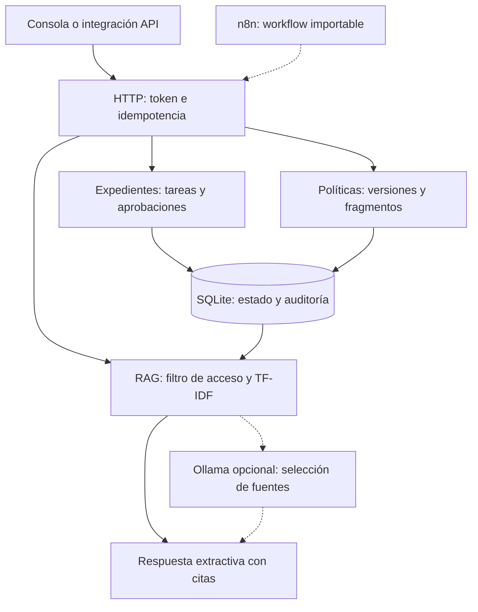

# Arquitectura

[Abrir SVG](diagrams/architecture.svg) · [Fuente Mermaid](diagrams/architecture.mmd)

El servicio coordina expedientes de onboarding y resuelve consultas sobre políticas. Las decisiones del expediente permanecen en el motor de reglas; la recuperación y el modelo sólo producen información con fuentes.

Versión Mermaid

| Componente | Responsabilidad |
| --- | --- |
| Entrada HTTP | Autenticar la integración, limitar el cuerpo y reutilizar respuestas con la misma clave. |
| Expedientes | Validar rol, calendario, dependencias y aprobaciones antes de registrar tareas completadas. |
| Políticas | Recibir texto por API, versionar cambios y sustituir fragmentos de la versión anterior. |
| Recuperación | Filtrar organización y grupos antes del ranking; devolver hasta tres fragmentos pertinentes. |
| Modelo opcional | Elegir únicamente identificadores de fuentes recuperadas; no redactar hechos nuevos ni aprobar tareas. |
| Persistencia | Conservar estado, solicitudes y auditoría bajo una transacción local. |

Las citas incluyen política, título, versión e identificador estable del fragmento. La respuesta final contiene extractos exactos. Si no hay evidencia suficiente, el servicio se abstiene. No se usan embeddings ni una base vectorial externa en este motor local.

El registro de revisiones conserva organización, identificador de política y última versión tras borrar el contenido. Recrear una política incrementa esa versión y evita reutilizar citas o aceptar una revisión antigua sobre el nuevo documento.

El workflow n8n y el contenedor son componentes de entrega incluidos; requieren configuración y validación en su entorno. Las políticas aíslan `tenant` y `groups`; los expedientes existentes representan una sola organización operadora. El token es de integración y confía en esos atributos: una pasarela corporativa debe derivarlos de la identidad autenticada.

[Flujo de operación](flow.md) · [Tecnologías](technologies.md) · [Decisiones](decisions.md)
