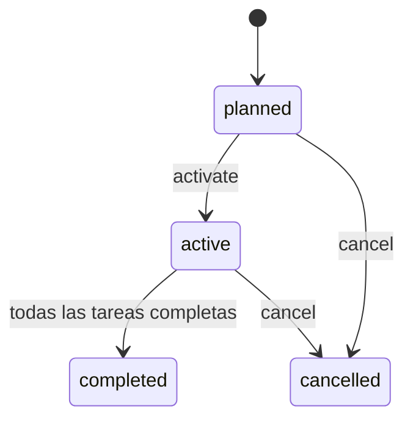

# Expedientes y dependencias

Un expediente contiene una referencia interna del empleado, rol, fecha de inicio y tareas. Cada tarea tiene dependencias, vencimiento y una aprobación opcional. El dominio comprueba las dependencias al completar; una aprobación anticipada no las omite.

La unicidad de `employee_ref` impide crear incorporaciones duplicadas. La misma referencia con rol o fecha distintos produce un error. La capa HTTP mantiene además la respuesta de cada solicitud idempotente. La actualización del expediente y su evento de auditoría comparten la transacción local.

El componente de resumen recibe solamente estado y nombres de tareas pendientes. No recibe la referencia del empleado ni ejecuta herramientas. Su salida se acompaña del estado estructurado para que el consumidor no interprete una frase como una autorización.

El servicio registra confirmaciones de procesos externos. La provisión de cuentas, verificación de identidad y lectura de políticas deben ser realizadas por sus sistemas responsables antes de completar la tarea correspondiente.
