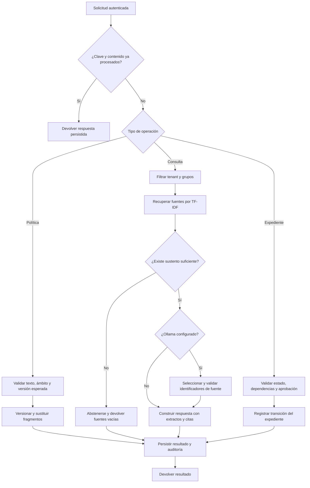

# Flujo de operación

[Abrir SVG](diagrams/flow.svg) · [Fuente Mermaid](diagrams/flow.mmd)

El mismo contrato HTTP ofrece tres recorridos: administrar políticas, consultar información y registrar el avance de una incorporación. Una consulta no cambia aprobaciones ni tareas.

Versión Mermaid

- **Políticas:** `policy_ingest` crea o actualiza una versión; `policy_delete` exige la versión vigente y retira sus fragmentos del índice activo.
- **Consultas:** `query_policy` recibe pregunta, organización y grupos. El ranking se calcula sólo con documentos visibles. El modelo, cuando está configurado, recibe esos fragmentos y no el expediente del empleado.
- **Expedientes:** `create`, `activate`, `approve`, `complete` y `cancel` aplican reglas de estado. La aprobación anticipada no permite omitir dependencias.
- **Errores:** validaciones, fuentes inventadas o fallo del proveedor revierten la transacción. La misma clave puede reintentarse después de una operación fallida.

Las consultas conservadas por idempotencia son evidencia histórica de la respuesta original: cambiar o borrar una política no purga respuestas ya almacenadas. La retención debe definirse con los responsables de datos antes de una operación real.
